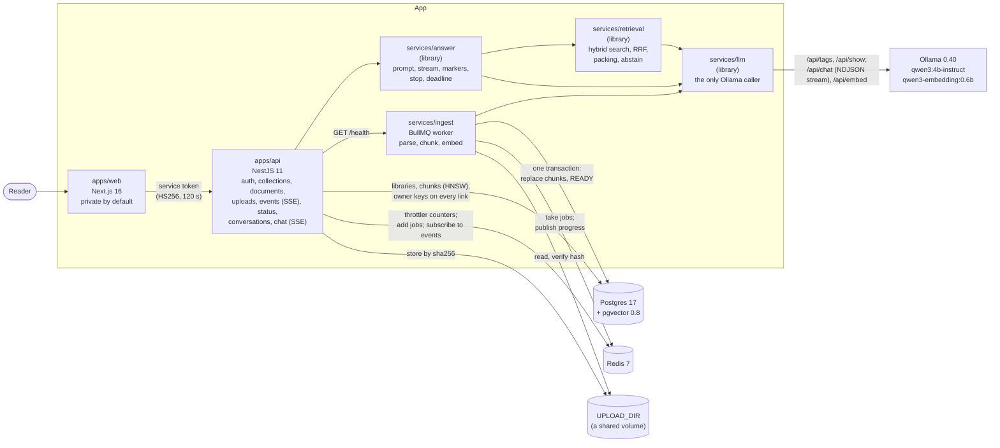

# rag-assistant: answers from your own documents, every claim cited, on an open model

[](https://github.com/bastian-red/rag-assistant/actions/workflows/ci.yml)

A question-answering assistant over documents you upload. Each person has a private library of
PDFs, markdown and text; an ingestion queue parses, chunks and embeds them into Postgres
(pgvector), and a question is answered by an open-weight model running locally under Ollama,
streamed token by token, with every claim pointing at the passage it came from. When the library
does not hold the answer, it says so instead of inventing one.

> **Status: build step 7 of 11, the chat stream.** What exists today: sign-in for two seeded accounts,
> each with a private library of collections and documents; a private-by-default web app that lists
> your collections; the API with its default-closed guard and documented rate-limit budgets; the
> full data model in Postgres with pgvector, where no row can point at another person's row;
> `services/llm`, the one place that talks to the model server, with an Ollama-compatible fake for
> CI; and `services/ingest`, a BullMQ worker that parses (PDF pages kept), chunks, embeds and
> stores every upload, retrying what is worth retrying and refusing what is not. The API takes
> uploads (`POST /documents`: checked by their bytes, capped at 20 MiB, one document per file
> however often it is sent, its own per-person budget), serves documents, their files and their
> passages, and streams ingest progress over SSE. The seeded documents are read by the worker
> like any upload and show as "ready to ask about". `services/retrieval` finds the passages for a
> question: vector and full-text search in one person's library, fused, packed for the prompt, or
> an honest "not found" (p95 56 ms over 5,000 chunks). `services/answer` turns a question into
> a cited answer, and the API streams it over SSE (`POST /chat/:id/messages`): sources first,
> then tokens with citations checked against what was retrieved, a Stop that stops the model, and
> every answer stored with its citations and a full retrieval trace. The eval suite and the
> interface arrive in steps 8 to 11, each with its tests. The demo GIF lands with the interface
> (step 11). Nothing here describes a feature that is not in the code.



The browser only talks to `apps/web`. The web tier holds no database credentials (a lint rule
refuses `@rag/db`, Prisma, Redis and BullMQ imports there), and no code outside `services/llm`
calls the model server.

## Why an open model, and which one

The model is `qwen3:4b-instruct` (chat, the 2507 instruct build) with `qwen3-embedding:0.6b`
(embeddings), served by Ollama on the same machine. The 4B chat model is the strongest that answers
at a usable speed on an 8-core CPU with 11 GB of RAM and no GPU, which is the machine this was built
on; the names live in `.env` (`CHAT_MODEL`, `EMBED_MODEL`), so a larger model on a bigger machine is
a one-line change. No proprietary inference API is called anywhere.

It has to be an instruct build. Plain `qwen3:4b` is the same weights as
`qwen3:4b-thinking-2507`: measured on this machine, with thinking off it wrote its reasoning into
the answer untagged, and with thinking on it spent 551 s on 1,500 reasoning tokens without reaching
an answer. The instruct build answered the same 1,031-token prompt in 75 s cold, citing its source.
Ollama's `/api/show` says which kind a build is (`thinking: {values: [true]}` means it cannot turn
thinking off), so `/health` reports a thinking-only chat model as not ready, by name, instead of
letting every answer fail slowly.

## The data model

One rule shapes every table: a row belongs to exactly one person, and the database makes it
impossible for a row to point at someone else's. Every owned table carries `owner_id`, and every
link between owned tables is a composite foreign key over `(id, owner_id)`. A document cannot sit
in another person's collection, a chunk cannot belong to another person's document, and an answer
of Alma's cannot cite a passage of Bruno's. Each of those writes is refused by name in
`packages/db/test/library.test.ts`.

```
users ─┬─ collections ── documents ── chunks (text, halfvec(1024), tsvector)
       │                                 │
       └─ conversations ── messages ─┬─ citations ──┘ (chunk_id SET NULL on delete)
                                     └─ retrieval_traces
```

- **Chunks** keep the exact span they came from (`char_start`, `char_end`, and the page range for
  a PDF), and a CHECK holds the text to its span, so a citation highlights exactly what the model
  was shown. The embedding is `halfvec(1024)` (qwen3-embedding:0.6b is 1024-wide and
  unit-normalised) under an HNSW cosine index, and `tsv` is a generated English full-text vector
  under GIN. A zero vector is refused, because its cosine distance is NaN and would silently drop
  the chunk from every result.
- **The owner filter runs inside the nearest-neighbour scan**, so the retrieval query needs
  pgvector 0.8's iterative scan. `test/retrieval-index.test.ts` shows why: when another person's
  rows are all closer, the plain HNSW scan returns fewer than k of yours, and the iterative scan
  returns the same six as an exact search.
- **Deletes keep the history.** Deleting a collection keeps its conversations, and deleting a
  document keeps every citation of it with the title, page and quote copied at answer time. Those
  two keys clear one column (`ON DELETE SET NULL (col)`, Postgres 15+), because a plain `SET NULL`
  would also null the owner.
- **One streaming answer per conversation**, by a partial unique index, so a reload or a second
  tab cannot start a second generation.
- A second upload of the same bytes by the same person is the same document (`owner_id, sha256`).

`scripts/db-drift.mjs` checks the live database against `schema.prisma`, minus the four objects
Prisma cannot declare (listed in `packages/db/src/constraints.ts`). It also checks every applied
migration's checksum against its file, because `migrate deploy` never re-applies an edited
migration and a database migrated before the edit keeps the old SQL.

The seed gives Alma home paperwork and a bike log, and Bruno lab procedures. One of Bruno's files
holds a canary phrase that must never reach anything of Alma's. `scripts/seed-check.sh` checks that
the phrase is in exactly one of Bruno's documents and in no row of Alma's in any table, and the seed
refuses to write anything if the corpus breaks that rule.

## Chunks and citations

A citation is only as good as the span it points at, so both libraries work in exact offsets
into one text and never approximate one.

**One text.** `normalise()` runs once per document: line endings to `\n`, tabs and Unicode
spaces to a space, soft hyphens, zero-width and control characters removed, then NFC (in that
order: composing first would leave an `e`, a zero-width space and an accent that only compose on a
second pass, and normalising would not be idempotent). A PDF's pages are normalised one by one and
joined with a blank line, and every page keeps its span, empty pages included.

**Offsets in code points.** Postgres `char_length` counts code points and JavaScript strings
count UTF-16 units; they disagree on every emoji. Every stored offset (`chunks.char_start`,
`citations.quote_start`) is in code points, which is what the `char_length(text) = char_end -
char_start` CHECK holds the database to.

**Chunks.** The document is read as units: headings, sentences (ICU's `Intl.Segmenter`, with the
break after "Dr." and an initial suppressed, and hard-wrapped lines read through), list items,
table rows and code lines. Units are packed toward 400 estimated tokens, never over 512, with up
to 60 tokens of whole units shared between neighbours in a section and none across a heading. A
heading never ends a chunk: it moves forward to the text it heads, and each chunk is filed under
the headings its text sits in. Only a unit too big for a chunk is cut, to the room left, at
whitespace, and a single word too big for that between code points.

**Token estimate.** There is no tokenizer dependency. `estimateTokens` is a fit over character
classes against 72 samples measured on the embedding model (`pnpm --filter @rag/chunker
calibrate` re-measures them), scaled to err high: the worst passage of 20+ tokens is estimated at
0.87 of its true count, the median at 1.20. The usual `chars / 4` undercounts 18 of the 72, the
worst at 0.31, because Qwen spends one token per digit.

**Markers.** The model is asked for `[S1]`. `createMarkerStream` reads the token stream and
accepts `[S1, S3]`, `[S1;S2]`, `[s2]` and `[S2-S4]`, writes each as `[S1][S3]`, drops every label
that names no packed source and counts it (for the trace and the `done` event), and leaves other
brackets alone. It holds back a possible marker until it is decided, so the result is the same
however the answer is cut into tokens: that split invariance is a property test. Each citation
then resolves to the sentence of its chunk sharing the most content words with the claims that
cite it, stored as an exact code-point span with the page that span starts on (a chunk records
where each later page begins inside it, stored in `chunks.page_starts`).

## The model client

`services/llm` is the only code that talks to the model server. Other services code against
`LlmClient` in `@rag/shared`: `chat(messages, {signal})` yields visible text and then one `done`
with token counts and timings, `embed(texts)` returns one vector per text, and `models()` says
whether each configured model is pulled and able to do its job. Every wire shape below was
measured on Ollama 0.40.12 before the fake copied it.

- **No reasoning in answers.** Every chat asks for `think: false`. Reasoning that still arrives,
  in the `thinking` field or as a `<think>` block in the text, is removed and counted in
  `usage.thinkingDropped`. The block stripper gives the same text however the stream is cut
  (a property test), even with a tag split across two pieces.
- **Stop means stop.** Aborting the caller's signal, or leaving the loop, cancels the response
  body, which closes the request, and that is what stops the server generating. The contract
  suite asserts that the server saw the close. Tokens already read off the socket are not let
  through after a stop.
- **Two clocks.** The first visible token may take up to 180 s (the cold 4B load measured 65 s
  here). After that a gap of 30 s fails the answer. Time the consumer spends with a token
  (writing it to a socket) does not count against the model.
- **Embeddings are checked.** Batches of 32 go one at a time, so the caller sets the concurrency.
  Every batch is sent with `truncate: false`, so a passage over the context length is an error,
  not a silently shortened vector. Each reply must hold one finite vector per input, of the
  1,024 dimensions the `chunks.embedding` column has.
- **Ready is not reachable.** `models()` reads `/api/tags`, then `/api/show` for each pulled
  model. An embedding model configured as the chat model is "not a chat model". A build whose
  `thinking.values` is `[true]` is "a thinking-only build", and `/health` answers 503 naming it.
- **One error type.** Every failure is an `LlmError` with a stable code (`unreachable`,
  `model_not_found`, `model_unsupported`, `refused`, `failed`, `protocol`, `timeout`,
  `aborted`). Ollama's own reason is kept and the server's address never is.

Retrieved passages reach the prompt as `<source id="S1">` blocks (`formatSources` in
`@rag/shared`). A passage is data, so any `<source` or `</source` in its text is escaped and comes
back exactly on reading. A hostile document cannot close its own block or open a fake one.

The fake (`services/llm/src/fake/`) speaks the same HTTP. It embeds by feature hashing:
deterministic unit vectors in which texts that share words are near each other. It answers with
the first sentence of each source it was given plus that source's marker, cut into pieces of three
characters, so `[S12]` arrives split across two pieces as a real tokenizer would send it. It records
every chat, including whether the client hung up. Control routes let a spec in another process
change how it answers, stall it, crash it mid-answer, or take a model away.

## Ingestion

An upload is checked cheapest first and nothing is written until every check passes: the upload
budget (`RATE_LIMIT_UPLOAD`, per person, before the body is read), the size cap (20 MiB, 413), the
bytes against the name (a `.pdf` must start `%PDF-` within its first kilobyte, a `.md` or `.txt`
must be UTF-8 with no NUL and not a PDF: 415), then the collection being yours (404). The file is
stored at `UPLOAD_DIR/<owner>/<sha256>` before its row exists, so the worker never sees a row
without its file. The same bytes from the same person are the same document: 200 with the
existing one (a FAILED one is given another go, since its reason says "upload it again"), never a
second copy. Otherwise 202 with a QUEUED document and one BullMQ job whose id is the document id.

`services/ingest` takes the job:

```
load (by id and owner) -> PARSING -> read the file, verify its sha256 -> parse -> chunk
  -> EMBEDDING, progress per batch of 32 -> one transaction: lock the row, delete its chunks,
     insert the new set, READY
```

- **Nothing durable is written until the last step**, and that step replaces rather than appends.
  So a retry, a duplicate job, or a worker killed mid-embed all end with one gap-free chunk set.
  The integration lane kills a real worker process with SIGKILL between two embedding batches,
  starts another, and asserts READY with exactly the chunker's chunks, ordinals 0 to n-1.
- **The file's fault is final; the world's is retried.** A PDF with no text layer ("no text layer;
  OCR not supported"), a damaged or password-protected PDF, text that is not UTF-8, a passage over
  the model's context, a stored file that is missing or does not match its hash: FAILED at once,
  no retry, in words the page prints. A model server that is down, a timeout, Postgres
  restarting: retried five times, 5 s doubling, and only the last attempt marks it FAILED.
- **A deleted document stays deleted.** Every write is conditioned on the row still existing, so
  a document removed mid-ingest is never recreated, and its job ends quietly.
- **Reconcile, at start and every minute** (`INGEST_SWEEP_MS`). A document left QUEUED with no job
  (the API died between the row and the job, or Redis lost its data) is re-queued. So is a READY
  document whose chunks are in another vector space than the model server's (below). Adding is
  idempotent because the job id is the document id.
- **A vector knows which model made it.** `chunks.embedding_model` is `model@digest`
  (`qwen3-embedding:0.6b@ac6da0dfba84`), read from the model server's `/api/tags`, never from
  configuration, and read again after the last batch (a model re-pulled mid-document is retried).
  A name alone is not an identity: on 2026-11-05 the development database held the fake model
  server's hashed vectors labelled with the real model's name, and every question ranked by noise
  while looking normal. The fake now reports its own digest, so those chunks read as another
  space, and the worker embedded them again on its next start.
- **Progress is announced**, per owner, on Redis pub/sub; `GET /documents/events` streams the
  signed-in person's channel as SSE (`subscribed` first, then `ingest` events). One subscriber
  connection serves every open stream, and a channel is dropped when its last stream closes.

PDF text comes from unpdf 2.1 (pdf.js 5), one string per page, so a chunk knows its page range.

**An upload never sits in memory.** multer streams the body to `UPLOAD_DIR/.incoming/` through
an inspector that hashes it and keeps only its first 1,029 bytes (the PDF header window) and
16,384 characters (where the title is read); the type is judged from that, and the staged file
is renamed to its stored name or removed before the request returns. A 20 MiB upload costs the
API one 64 KB stream buffer. multer removes a part cut off mid-file; whatever a crash leaves (a
file renamed but never given its row, a staged part) the worker's sweep removes once it is ten
minutes old and no document names it. Downloads stream from an open handle the same way.

## Retrieval

`services/retrieval` is a library; `services/answer` calls it for every question:

```
question -> embed with the model's query instruction
  -> vector top 40 (HNSW cosine) + full-text top 40 (OR of English stems), the same scope
  -> reciprocal rank fusion (k = 60) -> top 6 distinct -> overlapping neighbours merged
  -> packed under 3,200 tokens as [S1]..[Sn]       or: abstain below similarity 0.43
```

- **Scope inside the SQL**: the asking person's chunks, of READY documents, in the current vector
  space, in one collection when asked of one. The integration lane asks for another person's canary
  phrase by its exact words, in all three modes, and asserts it is never a candidate.
- **Abstention reads the cosine similarity**, the only absolute signal: fused scores are ranks and
  look the same for an answer and for the least unrelated passage. 0.43 is the midpoint of the gap
  measured on the seeded corpus (best unanswerable question 0.338, worst answerable 0.526); the
  eval lane recalibrates it. An abstention returns the nearest passages to show, and the chat model
  is not called.
- **Merged neighbours are exact text.** Chunks inside a long section overlap by about 60 tokens;
  two selected neighbours become one source over the document's text, and a citation is still
  stored against the chunk its quote is in.
- **Every candidate is traced**: both ranks, both scores, the fused score and the marker it got.

Speed is SPECS #8, measured by `node scripts/retrieval-bench.mjs` (5,000 chunks each for two
people, 200 questions, in the integration lane):

| `retrieve()` p95 | Change                                                                                           |
| ---------------- | ------------------------------------------------------------------------------------------------ |
| 1,073 ms         | First run. The vector query took 6 ms inside Postgres                                            |
| 132 ms           | `plan_cache_mode = force_custom_plan`: a prepared statement's generic plan cannot use HNSW       |
| 56 ms            | Vectors kept in the row (`STORAGE PLAIN`, `toast_tuple_target 8160`): no TOAST read per distance |

## Running it

Requires pnpm 9 (it runs every command on the Node 24.22.2 LTS pinned in `.nvmrc`, downloading it once; `scripts/node-pin.mjs` holds `.npmrc`, the Dockerfiles, CI and `engines` to it), Docker, and about 4 GB free in `$HOME` for Ollama and the two models.

```bash
git clone https://github.com/bastian-red/rag-assistant.git && cd rag-assistant
pnpm install
cp .env.example .env
sed -i "s|^AUTH_SECRET=|AUTH_SECRET=$(openssl rand -base64 32)|" .env
docker compose -f infra/docker-compose.yml up -d     # Postgres (pgvector) :5445, Redis :6391
./scripts/ollama-setup.sh                             # Ollama, user-local, no sudo; pulls both models
pnpm db:deploy && pnpm db:seed
pnpm dev                                              # web :3600, api :4600, ingest :4500
```

Open <http://localhost:3600> and sign in with a seeded account (local accounts for a local
database, published on purpose):

| Email            | Password              |
| ---------------- | --------------------- |
| `alma@rag.test`  | `alma-password-2026`  |
| `bruno@rag.test` | `bruno-password-2026` |

Each account sees only its own library.

`scripts/ollama-setup.sh` installs a pinned Ollama release (version and SHA-256 written in the
script, verified before unpacking) into `~/.local/ollama/`, links it at `~/.local/bin/ollama`,
starts `ollama serve` if nothing answers at `OLLAMA_URL`, and pulls `CHAT_MODEL` and
`EMBED_MODEL`. It is idempotent; `--check` only reports. On macOS or Windows, install Ollama from
its site and run the script with `--check`.

`pnpm dev` runs `scripts/dev.sh`, which loads `.env` (falling back to `.env.example` for any name
it lacks, and making `UPLOAD_DIR` absolute, since the API and the worker run from different
directories), checks `AUTH_SECRET`, that Postgres and Redis
answer and that both models are pulled (printing the exact `ollama pull` if one is not), then
starts turbo. Turbo reads no `.env` itself and runs in strict environment mode, so without the
wrapper the API would boot with no secret. The web task waits for the API before `next dev`
opens its port, so the first page is never an "API unreachable" error.

The whole stack in containers: `docker compose -f infra/docker-compose.yml --profile app up -d
--build` (api, ingest worker and web; the api and the worker share an `uploads` volume). The containers use the host's Ollama through `host.docker.internal`, so the models are
downloaded once and stay out of the Docker disk. A machine with no host Ollama adds
`--profile ollama` (see the comment at the top of `infra/docker-compose.yml`).

## Testing

No CI lane runs a real model: GitHub's runners have no GPU and the models are gigabytes. Every
deterministic lane runs against the Ollama-compatible fake in `services/llm/src/fake/`. One
contract suite (`services/llm/test/contract.ts`) runs against the fake on every commit and against
the real Ollama with `pnpm llm:contract:real` (16 of 16 pass on `qwen3:4b-instruct` in about 45 s
with the models loaded). That second run is what keeps the fake honest. Answer quality is the eval
lane's job (step 8), against the real model.
Property tests run 60 cases each in the gate lane; `FC_RUNS=2000 pnpm --filter @rag/chunker test`
runs a deep search (it found two packing bugs the gate size missed, both now pinned by name).

| Lane                 | Command                       | What it proves                                                                                                                                                                                                                                                                                                                                                                                                                                                                                                                                                                                                                                                                                                                                                                                                                                                                                                                                                                                                                                                                                                                                                                                                                                                                                                                                                                                                                                                                                                                                                                                                                                                                                                                                                                                                                                                                                                                                                                                                                                                                                                                                                                                                                                                                                                                                                                                                                                                                                                                                                                                                                                                                                                                                                                                                                                                                                                                                                                                                                                                                                                                                                                                                                                                                                                                                                                                                                                                                                                                                                                                                                                                                                                                                                                                                                                                                                                                                                                                                                                                                                                                                                                                                                                                                                                                                                                                                                                                                                                                                                                                                                                                                                                                                                                                                                                                                                                                                                                                       |
| -------------------- | ----------------------------- | ---------------------------------------------------------------------------------------------------------------------------------------------------------------------------------------------------------------------------------------------------------------------------------------------------------------------------------------------------------------------------------------------------------------------------------------------------------------------------------------------------------------------------------------------------------------------------------------------------------------------------------------------------------------------------------------------------------------------------------------------------------------------------------------------------------------------------------------------------------------------------------------------------------------------------------------------------------------------------------------------------------------------------------------------------------------------------------------------------------------------------------------------------------------------------------------------------------------------------------------------------------------------------------------------------------------------------------------------------------------------------------------------------------------------------------------------------------------------------------------------------------------------------------------------------------------------------------------------------------------------------------------------------------------------------------------------------------------------------------------------------------------------------------------------------------------------------------------------------------------------------------------------------------------------------------------------------------------------------------------------------------------------------------------------------------------------------------------------------------------------------------------------------------------------------------------------------------------------------------------------------------------------------------------------------------------------------------------------------------------------------------------------------------------------------------------------------------------------------------------------------------------------------------------------------------------------------------------------------------------------------------------------------------------------------------------------------------------------------------------------------------------------------------------------------------------------------------------------------------------------------------------------------------------------------------------------------------------------------------------------------------------------------------------------------------------------------------------------------------------------------------------------------------------------------------------------------------------------------------------------------------------------------------------------------------------------------------------------------------------------------------------------------------------------------------------------------------------------------------------------------------------------------------------------------------------------------------------------------------------------------------------------------------------------------------------------------------------------------------------------------------------------------------------------------------------------------------------------------------------------------------------------------------------------------------------------------------------------------------------------------------------------------------------------------------------------------------------------------------------------------------------------------------------------------------------------------------------------------------------------------------------------------------------------------------------------------------------------------------------------------------------------------------------------------------------------------------------------------------------------------------------------------------------------------------------------------------------------------------------------------------------------------------------------------------------------------------------------------------------------------------------------------------------------------------------------------------------------------------------------------------------------------------------------------------------------------------------------------------------------------- |
| Gate (every commit)  | `pnpm test`                   | The chat stream contract: six events, each validated on the way out and in, the SSE parser giving the same frames however the bytes are cut (CRLF split between CR and LF included), a body cut inside a multi-byte character; the answer run against an in-memory model: retrieval before the first token, citations once each, a marker naming nothing packed dropped and counted and the same result over any cut of the tokens, an abstention that never calls the model, a stop that keeps exactly the text sent (not a half-held `[S`) and aborts the call, a stop during retrieval, the deadline, a broken-off answer, failures said in fixed sentences; the prompt (sources only in the last message, a passage that cannot forge the question, history newest first within its budget with markers removed); the chat budget scoped to questions; Retrieval's pure parts: reciprocal rank fusion and its total order, selection skipping a repeated passage, neighbours merged only when their spans overlap and agree, packing under the budget counted as the prompt's blocks (a property test: every merged source is the exact document text and every citation of it lands on a chunk it holds), the abstain rule; the vector space as `model@digest` from the server (the fake's own digest, a server with none refused); uploads checked by their bytes (a `.pdf` that is not a PDF, a PDF renamed `.md`, Latin-1 named `.txt`) and the streamed inspection equal to the whole-buffer one however the upload is cut, with a bounded head; the upload sweep removing old files no row names and old partials while keeping fresh ones; stored files streamed from an open handle; stored-file paths that cannot leave their folder, titles and file names cut on code points, the upload budget scoped to uploads; the PDF parser keeping pages and refusing a scan and a damaged file; which ingest failures are retried and which are final; the fake's embed levers (a delay, injected 500s, the context-length refusal); contracts and model-name normalisation (an untagged name is `:latest`, a registry port is not a tag); the model client against present, missing and resized models, a refused connection (reported without the address), an HTML page and another service's JSON on the port, a 502 and a timeout; service tokens (incl. the `alg: none` forgery), config parsing, error mapping (including the P2010 shape every raw-SQL write fails with, whose SQLSTATE is in `meta.code` and whose unique index is named only by its columns), the hashed rate-limit key, the private-by-default sign-in gate; every constraint name the code matches on present in a migration, and every limit, MIME type and status in the migrations equal to the one in `@rag/shared`; document counts that always add up, said in words with absence said; chunking over generated documents with CRLF, tabs, no-break and zero-width spaces, emoji and giant words (every chunk exactly its code-point span, the chunks stitched minus overlap equal to the source, none blank, none over 512 tokens, overlap within 60, every boundary on a unit boundary unless a unit had to be cut, no chunk ending on a heading, page ranges equal to a linear scan of the pages), normalisation idempotent and lossless, the token estimate against the measured counts; markers split-invariant over any cut of the stream, invalid labels dropped and counted, quotes exact code-point spans of their chunk; source blocks read back exactly from any text, and no passage able to close its block; the llm contract against the fake (streamed text then one `done` with counts, a cited source, stop and early exit seen by the server, missing and wrong-kind models, unit 1,024-dimension embeddings, batching that keeps order); reasoning stripped however the stream is cut, the first-token and idle clocks, a slow consumer not mistaken for a silent model, an error line mid-answer, malformed and truncated streams, embed replies with the wrong count, size or values refused                                                                                                                                                                                                                                                                                                                                                                                                                                                                                                                                                                                                                                                                                                                                                                                                                                                                                           |
| LLM contract (real)  | `pnpm llm:contract:real`      | The same contract suite as the gate lane, against the Ollama in `.env`; local only, since a CI runner has no model server. `LLM_CONTRACT_THINKING_MODEL=qwen3:4b` also checks that a thinking-only build is reported as unfit                                                                                                                                                                                                                                                                                                                                                                                                                                                                                                                                                                                                                                                                                                                                                                                                                                                                                                                                                                                                                                                                                                                                                                                                                                                                                                                                                                                                                                                                                                                                                                                                                                                                                                                                                                                                                                                                                                                                                                                                                                                                                                                                                                                                                                                                                                                                                                                                                                                                                                                                                                                                                                                                                                                                                                                                                                                                                                                                                                                                                                                                                                                                                                                                                                                                                                                                                                                                                                                                                                                                                                                                                                                                                                                                                                                                                                                                                                                                                                                                                                                                                                                                                                                                                                                                                                                                                                                                                                                                                                                                                                                                                                                                                                                                                                        |
| Environment contract | `pnpm env:contract`           | Source, `.env.example` and `turbo.json` agree in all four directions                                                                                                                                                                                                                                                                                                                                                                                                                                                                                                                                                                                                                                                                                                                                                                                                                                                                                                                                                                                                                                                                                                                                                                                                                                                                                                                                                                                                                                                                                                                                                                                                                                                                                                                                                                                                                                                                                                                                                                                                                                                                                                                                                                                                                                                                                                                                                                                                                                                                                                                                                                                                                                                                                                                                                                                                                                                                                                                                                                                                                                                                                                                                                                                                                                                                                                                                                                                                                                                                                                                                                                                                                                                                                                                                                                                                                                                                                                                                                                                                                                                                                                                                                                                                                                                                                                                                                                                                                                                                                                                                                                                                                                                                                                                                                                                                                                                                                                                                 |
| Seed check           | `./scripts/seed-check.sh`     | The seed is deterministic and idempotent (two runs, one digest over people, collections and documents), every person has a library, every document is exactly its corpus file's bytes (sha256 and size), and the canary is in exactly one of Bruno's documents and in no row of Alma's, in any table that holds text                                                                                                                                                                                                                                                                                                                                                                                                                                                                                                                                                                                                                                                                                                                                                                                                                                                                                                                                                                                                                                                                                                                                                                                                                                                                                                                                                                                                                                                                                                                                                                                                                                                                                                                                                                                                                                                                                                                                                                                                                                                                                                                                                                                                                                                                                                                                                                                                                                                                                                                                                                                                                                                                                                                                                                                                                                                                                                                                                                                                                                                                                                                                                                                                                                                                                                                                                                                                                                                                                                                                                                                                                                                                                                                                                                                                                                                                                                                                                                                                                                                                                                                                                                                                                                                                                                                                                                                                                                                                                                                                                                                                                                                                                 |
| Schema drift         | `./scripts/db-drift.sh`       | The live database matches the Prisma schema column for column (`migrate status` only reads the ledger), and every applied migration's checksum matches its file                                                                                                                                                                                                                                                                                                                                                                                                                                                                                                                                                                                                                                                                                                                                                                                                                                                                                                                                                                                                                                                                                                                                                                                                                                                                                                                                                                                                                                                                                                                                                                                                                                                                                                                                                                                                                                                                                                                                                                                                                                                                                                                                                                                                                                                                                                                                                                                                                                                                                                                                                                                                                                                                                                                                                                                                                                                                                                                                                                                                                                                                                                                                                                                                                                                                                                                                                                                                                                                                                                                                                                                                                                                                                                                                                                                                                                                                                                                                                                                                                                                                                                                                                                                                                                                                                                                                                                                                                                                                                                                                                                                                                                                                                                                                                                                                                                      |
| Integration          | `./scripts/integration.sh`    | The ingest worker on real Postgres, Redis and the fake: a markdown document READY with exactly the chunker's chunks, 1,024-wide vectors and its events in order; run twice, one chunk set, replaced; a PDF keeping its pages; a scan FAILED as "no text layer; OCR not supported" without a retry; a model fault retried and left in progress, then FAILED with the model's reason on the last attempt; a passage over the context, a missing file, a deleted document and a stale job; a second `add` for one document a no-op; a stored file no row names removed by the sweep past its grace while a document's file and a fresh one stay; unfinished documents re-queued at start; READY documents embedded in another vector space (the bare model name the fake once wrote under) embedded again, at start and by the periodic sweep, and ones in the current space left alone; a model changing between the first and last batch writing nothing; `/health` 503 naming the embedding model; a worker process SIGKILLed mid-embed and a second one finishing READY with no duplicates. Then retrieval: another person's canary never a candidate in vector, text or hybrid mode even when asked by its exact words (and found by its owner); a person's own k nearest when another person's rows are all nearer; READY documents only, one collection or the whole library, the current vector space only with the others counted; full text matching any stem of the question; two overlapping neighbours merged into one source of the exact document text, both traced with its marker; an abstention with its similarity and the nearest passages, and none packed; then the bench (SPECS #8: `retrieve()` p95 under 150 ms over 5,000 chunks, with the HNSW plan printed). Then the API: uploads stored by hash and queued (202), the same bytes answered with the existing document (200), a FAILED one re-queued, a `.pdf` that is not a PDF refused (415) and a file one byte over the cap refused (413) with nothing stored or left staged, a request hung up mid-file leaving nothing staged, a file exactly at the cap stored byte for byte, a collection not yours (404), 10 uploads a minute per person and that budget limiting nothing else, documents, files (`nosniff`, sandbox CSP) and passages only to their owner, deletes removing file and job, collections created (409 on a name taken) and deleted with their files, two live event streams each hearing only its own person, `/status` with the worker's own report, unreachable, and hung; then the chat stream over the fake model: retrieval before the first token and the answer stored as sent with its citation's exact span and its trace; a marker naming nothing packed dropped and counted in `done` and the trace; history carrying the earlier exchange without its markers and the sources only once; an abstention with the nearest passages and no model call, `no_candidates` for an empty library, and neither kept as history; Stop leaving a STOPPED answer the fake saw aborted, shown once on reload; 409 while an answer is written and exactly one of two simultaneous questions through; an answer a dead process left behind settled on read and on the next question; a broken-off answer FAILED with its partial text; a document deleted mid-answer keeping its citation's words, and a conversation deleted mid-answer storing nothing; another person's canary absent from the stream, the prompt, the stored answer and the trace (and found by its owner); 404 for another person's conversation; a collection's conversation searching that collection; 400s and the 401; 20 questions a minute per person, then 429, limiting nothing else; conversations listed by activity and deleted with their messages. Before both: the `vector` extension at 0.8 or later; every composite key refusing a link to another person's row (document, chunk, conversation, message, citation, trace), what each delete removes and keeps, every unique (including one streaming answer per conversation) and every CHECK refusing its malformed row by name (including a chunk's page starts, whose order and bounds a SQL function checks); the HNSW and GIN indexes used (read from EXPLAIN), the generated `tsv` stemmed and kept in step, and the owner-filtered nearest-neighbour query returning the exact six under iterative scan where the plain scan comes back short; then the real Nest graph on Postgres and Redis at the documented budgets: sign-in, one answer for a wrong password and an unknown address, the default-closed guard, the exact route table, 5 sign-ins a minute per address and that budget limiting nothing else, `GET /collections` listing only the asker's collections with counts by state; `/health` 503 naming a missing model with the command that fixes it, naming a thinking-only chat build, and naming a dead model server without its address |
| Red proofs           | `node scripts/red-proofs.mjs` | Breaks each guarantee in the source (the default-closed guard, the auth budget's scope, the hashed limiter key, the models check, the model client's shape check, `:latest` resolution, the collections owner filter, both halves of raw-SQL error classification, the reading states in the counts, "No documents yet", the private-by-default gate, code-point chunk and quote offsets, the astral check, abbreviation suppression, the overlap budget, headings moving forward, the NFC order, the digit weight, the marker hold, invalid-label dropping, leading-marker attribution, the quote's own page, the page-starts CHECK, thinking-only detection and its health check, the think stripper, closing the request on early exit, tokens after a stop, the first-token clock, the consumer's time, the embed count check, the source fence, the fake's abort record, chunks replaced rather than appended, the scanned-PDF refusal, refusals not retried, a killed worker's job picked up again, the upload budget's scope, magic bytes, the documents owner filter, per-person event routing, the worker on `/status`, markers checked against the packed sources in the run and in the API, the abstention skipping the model, Stop aborting the model, a stop not stored as a failure, history markers removed, abstentions kept out of history, the conversation owner filter, citations of a chunk deleted mid-answer, orphaned answers settled, the chat budget's scope, the upload sweep's row check and its wiring, staged uploads removed when refused and when cut off, the streaming decoder), runs the suite that claims it, and fails unless that suite goes red                                                                                                                                                                                                                                                                                                                                                                                                                                                                                                                                                                                                                                                                                                                                                                                                                                                                                                                                                                                                                                                                                                                                                                                                                                                                                                                                                                                                                                                                                                                                                                                                                                                                                                                                                                                                                                                                                                                                                                                                                                                                                                                                                                                                                                                                                                                                                                                                                                                                                                                                                                                                                                                                                                                                                                                                                                                                                                                                                                                                                                                                                                                                                                                                                                                                                                               |
| E2E                  | `./scripts/e2e.sh`            | Production build, Chromium and Firefox: sign-in for both accounts, each seeing only their own collections, deep links kept through sign-in, open-redirect refusal, the library private when signed out and again after sign-out, the seeded documents read by the ingest worker until the library says "ready to ask about", `/health` on the api and the worker and `/status` showing both, including the degraded state on both cards when the embedding model goes missing, axe with zero violations on every route in both colour schemes, no sideways scroll at 390 px                                                                                                                                                                                                                                                                                                                                                                                                                                                                                                                                                                                                                                                                                                                                                                                                                                                                                                                                                                                                                                                                                                                                                                                                                                                                                                                                                                                                                                                                                                                                                                                                                                                                                                                                                                                                                                                                                                                                                                                                                                                                                                                                                                                                                                                                                                                                                                                                                                                                                                                                                                                                                                                                                                                                                                                                                                                                                                                                                                                                                                                                                                                                                                                                                                                                                                                                                                                                                                                                                                                                                                                                                                                                                                                                                                                                                                                                                                                                                                                                                                                                                                                                                                                                                                                                                                                                                                                                                          |
| Dev smoke            | `./scripts/dev-smoke.sh`      | The documented `pnpm dev` from a cold start, with every `.env` name stripped from its own environment: `/status` says every service is up on the very first request and lists the ingest worker, `/health` on the api sees Postgres, Redis, the model server, both models and the upload folder, the worker's sees its own five checks, and a sign-in reaches Postgres through the API and lists the seeded person's collections                                                                                                                                                                                                                                                                                                                                                                                                                                                                                                                                                                                                                                                                                                                                                                                                                                                                                                                                                                                                                                                                                                                                                                                                                                                                                                                                                                                                                                                                                                                                                                                                                                                                                                                                                                                                                                                                                                                                                                                                                                                                                                                                                                                                                                                                                                                                                                                                                                                                                                                                                                                                                                                                                                                                                                                                                                                                                                                                                                                                                                                                                                                                                                                                                                                                                                                                                                                                                                                                                                                                                                                                                                                                                                                                                                                                                                                                                                                                                                                                                                                                                                                                                                                                                                                                                                                                                                                                                                                                                                                                                                     |

## Asking

`POST /chat/:conversationId/messages` with `{"content": "..."}` answers `text/event-stream`
(contract v1, `packages/shared/src/contracts/chat.ts`; read with fetch and a ReadableStream,
because the request has a body and a token). Everything that can be refused is refused first, as
plain JSON: 400 for the body, 404 for a conversation that is not yours, 409 while an answer in it
is still being written, 429 past the chat budget (20 questions a minute per person, which limits
nothing else). Then:

| Event       | When                                | Carries                                                                     |
| ----------- | ----------------------------------- | --------------------------------------------------------------------------- |
| `retrieval` | always first                        | the stored question and answer ids, the sources `[S1]..[Sn]` with snippets  |
| `token`     | as the model writes                 | visible text, markers canonical (`[S1][S3]`)                                |
| `citation`  | a marker's first use                | the marker, its document and chunk                                          |
| `abstain`   | nothing close enough: no model call | "Not found in your documents.", the similarity, the nearest passages        |
| `done`      | the answer is stored                | the resolved citations (chunk, quote, page), dropped markers, usage, timing |
| `error`     | after the stream started, instead   | a code (`unavailable`, `failed`, `timeout`, `internal`) and a sentence      |

- **Markers are checked against what was retrieved.** A `[S7]` when six sources were packed never
  reaches the reader; it is dropped, counted in `done` and in the trace (SPECS #2). A marker cut
  across two tokens is still one marker.
- **Stop stops the model.** Closing the request aborts the model call (the fake model server
  records the abort) and stores the answer STOPPED with exactly the text that was sent (SPECS #5).
  Reading the conversation again shows that answer, and generates nothing.
- **One answer at a time per conversation**, held by a partial unique index. A process that dies
  mid-answer cannot block a conversation: every answer stops itself after 5 minutes, so a
  STREAMING row older than that plus a minute is settled as FAILED when the conversation is read
  or asked again.
- **History**: the prompt carries up to three earlier finished exchanges (1,200 estimated
  tokens), their markers removed, so an old `[S2]` cannot read as this turn's S2. Sources go only
  in the last message, fenced as data.
- **Every answer is auditable**: the trace stores every candidate with its ranks and scores, the
  abstain verdict and the similarity it compared, dropped markers, the prompt version, history
  length, timings and the model's token counts. Citations copy their title, page and quote, so an
  answer whose document was deleted, even mid-answer, still says what it cited.
- **Isolation, end to end** (SPECS #3): the integration lane puts a canary phrase in one person's
  library and asks another person's conversation for it. The canary is absent from the whole
  stream, the prompt the model server received, the stored answer, citations and trace, and
  every traced candidate is the asker's own chunk; the same question from the canary's owner
  finds it, so the absence means something.

The integration and E2E lanes set `RETRIEVAL_MIN_SIMILARITY=0.12`: the fake model server's hashed
vectors are their own space (unrelated text about 0.07, related 0.16 to 0.35), and the real
model's 0.43 would abstain on every question there.

The pre-commit hook runs gitleaks, the environment contract, the invisible-character and
self-import scans with their self-tests, the lockfile check and the gate lane. CI runs every lane
above plus lint, typecheck, a dependency audit and the three Docker image builds (api, ingest,
web).

## Configuration

Every variable is documented in [`.env.example`](.env.example). `node scripts/env-contract.mjs`
fails if the code reads a name that `turbo.json` does not pass through or `.env.example` does not
document.

## Layout

```
apps/web         Next.js 16: sign-in, the library (your collections and their documents), status
apps/api         NestJS 11: auth, collections, documents and uploads, ingest events (SSE), health
                 (Postgres, Redis, model server, models, uploads), status (api and worker),
                 conversations, the chat stream (SSE) and what it stores
services/ingest  the BullMQ worker: parse (unpdf, pages kept), chunk, embed, replace chunks in one
                 transaction; retries, refusals, the reconcile sweep (and re-embedding), its /health
services/answer  one question to one cited answer: the prompt, the streamed call, markers checked
                 against the packed sources, stop and deadline; the API and the eval lane share it
services/retrieval  hybrid search (HNSW + full text), RRF, neighbour merging, packing under a token
                 budget, the abstain rule, the trace; scripts/retrieval-bench.mjs times it
services/llm     the only caller of Ollama: model checks, streamed chat, batched embeddings; an
                 Ollama-compatible fake for every lane with no model; the shared contract suite
packages/db      Prisma schema, migrations (pgvector, HNSW, composite owner keys, CHECKs), the seed
                 and its corpus, schema tests
packages/chunker   normalisation, units, packing, code-point spans and pages, the token estimate
packages/citations [Sn] markers from a stream, validation against packed sources, quote spans
packages/shared  zod contracts (auth, health, the llm client, source blocks, the library, ingest,
                 conversations and the chat stream with its SSE parser),
                 error vocabulary, service tokens, file storage by hash, type sniffing
packages/config  shared tsconfig
infra/           docker-compose (pgvector, Redis, an optional Ollama) and one Dockerfile per process
e2e/             Playwright
scripts/         dev launcher, Ollama setup, lane scripts, contract checks, red proofs
```
