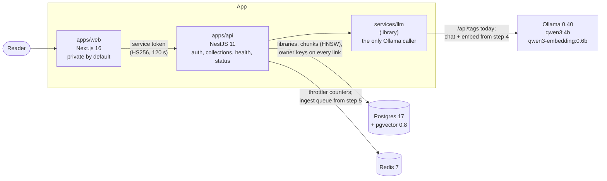

# rag-assistant: answers from your own documents, every claim cited, on an open model

[](https://github.com/bastian-red/rag-assistant/actions/workflows/ci.yml)

A question-answering assistant over documents you upload. Each person has a private library of
PDFs, markdown and text; an ingestion queue parses, chunks and embeds them into Postgres
(pgvector), and a question is answered by an open-weight model running locally under Ollama,
streamed token by token, with every claim pointing at the passage it came from. When the library
does not hold the answer, it says so instead of inventing one.

> **Status: build step 3 of 11, chunking and citations.** What exists today: sign-in for two seeded
> accounts, each with a private library of collections and documents; a private-by-default web
> app that lists your collections; the API with its default-closed guard and documented rate-limit
> budgets; the full data model in Postgres with pgvector (chunks with `halfvec` embeddings and an
> HNSW index, full-text search, conversations, citations, retrieval traces), where no row can point
> at another person's row; Redis; and `services/llm`, the one place that talks to the model server,
> with an Ollama-compatible fake for CI. `/health` checks Postgres, Redis, the model server and that
> both models are pulled. `packages/chunker` turns a document into chunks with exact spans and
> page ranges, and `packages/citations` reads `[S1]` markers out of a token stream; both are pure
> libraries with property tests, waiting for their callers. The seeded documents wait as "still being read" until
> the ingest worker (step 5) reads them. Ingestion, retrieval, the chat stream, the eval suite and
> the design arrive in steps 4 to 11, each with its tests. The demo GIF lands with the interface
> (step 11). Nothing here describes a feature that is not in the code.



The browser only talks to `apps/web`. The web tier holds no database credentials (a lint rule
refuses `@rag/db`, Prisma, Redis and BullMQ imports there), and no code outside `services/llm`
calls the model server.

## Why an open model, and which one

The model is `qwen3:4b` (chat) with `qwen3-embedding:0.6b` (embeddings), served by Ollama on the
same machine. The 4B chat model is the strongest that answers at a usable speed on an 8-core CPU
with 11 GB of RAM and no GPU, which is the machine this was built on; the names live in `.env`
(`CHAT_MODEL`, `EMBED_MODEL`), so a larger model on a bigger machine is a one-line change. No
proprietary inference API is called anywhere.

## The data model

One rule shapes every table: a row belongs to exactly one person, and the database makes it
impossible for a row to point at someone else's. Every owned table carries `owner_id`, and every
link between owned tables is a composite foreign key over `(id, owner_id)`. A document cannot sit
in another person's collection, a chunk cannot belong to another person's document, and an answer
of Alma's cannot cite a passage of Bruno's. Each of those writes is refused by name in
`packages/db/test/library.test.ts`.

```
users ─┬─ collections ── documents ── chunks (text, halfvec(1024), tsvector)
       │                                 │
       └─ conversations ── messages ─┬─ citations ──┘ (chunk_id SET NULL on delete)
                                     └─ retrieval_traces
```

- **Chunks** keep the exact span they came from (`char_start`, `char_end`, and the page range for
  a PDF), and a CHECK holds the text to its span, so a citation highlights exactly what the model
  was shown. The embedding is `halfvec(1024)` (qwen3-embedding:0.6b is 1024-wide and
  unit-normalised) under an HNSW cosine index, and `tsv` is a generated English full-text vector
  under GIN. A zero vector is refused, because its cosine distance is NaN and would silently drop
  the chunk from every result.
- **The owner filter runs inside the nearest-neighbour scan**, so the retrieval query needs
  pgvector 0.8's iterative scan. `test/retrieval-index.test.ts` shows why: when another person's
  rows are all closer, the plain HNSW scan returns fewer than k of yours, and the iterative scan
  returns the same six as an exact search.
- **Deletes keep the history.** Deleting a collection keeps its conversations, and deleting a
  document keeps every citation of it with the title, page and quote copied at answer time. Those
  two keys clear one column (`ON DELETE SET NULL (col)`, Postgres 15+), because a plain `SET NULL`
  would also null the owner.
- **One streaming answer per conversation**, by a partial unique index, so a reload or a second
  tab cannot start a second generation.
- A second upload of the same bytes by the same person is the same document (`owner_id, sha256`).

`scripts/db-drift.mjs` checks the live database against `schema.prisma`, minus the four objects
Prisma cannot declare (listed in `packages/db/src/constraints.ts`). It also checks every applied
migration's checksum against its file, because `migrate deploy` never re-applies an edited
migration and a database migrated before the edit keeps the old SQL.

The seed gives Alma home paperwork and a bike log, and Bruno lab procedures. One of Bruno's files
holds a canary phrase that must never reach anything of Alma's. `scripts/seed-check.sh` checks that
the phrase is in exactly one of Bruno's documents and in no row of Alma's in any table, and the seed
refuses to write anything if the corpus breaks that rule.

## Chunks and citations

A citation is only as good as the span it points at, so both libraries work in exact offsets
into one text and never approximate one.

**One text.** `normalise()` runs once per document: line endings to `\n`, tabs and Unicode
spaces to a space, soft hyphens, zero-width and control characters removed, then NFC (in that
order: composing first would leave an `e`, a zero-width space and an accent that only compose on a
second pass, and normalising would not be idempotent). A PDF's pages are normalised one by one and
joined with a blank line, and every page keeps its span, empty pages included.

**Offsets in code points.** Postgres `char_length` counts code points and JavaScript strings
count UTF-16 units; they disagree on every emoji. Every stored offset (`chunks.char_start`,
`citations.quote_start`) is in code points, which is what the `char_length(text) = char_end -
char_start` CHECK holds the database to.

**Chunks.** The document is read as units: headings, sentences (ICU's `Intl.Segmenter`, with the
break after "Dr." and an initial suppressed, and hard-wrapped lines read through), list items,
table rows and code lines. Units are packed toward 400 estimated tokens, never over 512, with up
to 60 tokens of whole units shared between neighbours in a section and none across a heading. A
heading never ends a chunk: it moves forward to the text it heads, and each chunk is filed under
the headings its text sits in. Only a unit too big for a chunk is cut, to the room left, at
whitespace, and a single word too big for that between code points.

**Token estimate.** There is no tokenizer dependency. `estimateTokens` is a fit over character
classes against 72 samples measured on the embedding model (`pnpm --filter @rag/chunker
calibrate` re-measures them), scaled to err high: the worst passage of 20+ tokens is estimated at
0.87 of its true count, the median at 1.20. The usual `chars / 4` undercounts 18 of the 72, the
worst at 0.31, because Qwen spends one token per digit.

**Markers.** The model is asked for `[S1]`. `createMarkerStream` reads the token stream and
accepts `[S1, S3]`, `[S1;S2]`, `[s2]` and `[S2-S4]`, writes each as `[S1][S3]`, drops every label
that names no packed source and counts it (for the trace and the `done` event), and leaves other
brackets alone. It holds back a possible marker until it is decided, so the result is the same
however the answer is cut into tokens: that split invariance is a property test. Each citation
then resolves to the sentence of its chunk sharing the most content words with the claims that
cite it, stored as an exact code-point span with the page that span starts on (a chunk records
where each later page begins inside it, stored in `chunks.page_starts`).

## Running it

Requires Node 20+, pnpm 9, Docker, and about 4 GB free in `$HOME` for Ollama and the two models.

```bash
git clone https://github.com/bastian-red/rag-assistant.git && cd rag-assistant
pnpm install
cp .env.example .env
sed -i "s|^AUTH_SECRET=|AUTH_SECRET=$(openssl rand -base64 32)|" .env
docker compose -f infra/docker-compose.yml up -d     # Postgres (pgvector) :5445, Redis :6391
./scripts/ollama-setup.sh                             # Ollama, user-local, no sudo; pulls both models
pnpm db:deploy && pnpm db:seed
pnpm dev                                              # web :3600, api :4600
```

Open <http://localhost:3600> and sign in with a seeded account (local accounts for a local
database, published on purpose):

| Email            | Password              |
| ---------------- | --------------------- |
| `alma@rag.test`  | `alma-password-2026`  |
| `bruno@rag.test` | `bruno-password-2026` |

Each account sees only its own library.

`scripts/ollama-setup.sh` installs a pinned Ollama release (version and SHA-256 written in the
script, verified before unpacking) into `~/.local/ollama/`, links it at `~/.local/bin/ollama`,
starts `ollama serve` if nothing answers at `OLLAMA_URL`, and pulls `CHAT_MODEL` and
`EMBED_MODEL`. It is idempotent; `--check` only reports. On macOS or Windows, install Ollama from
its site and run the script with `--check`.

`pnpm dev` runs `scripts/dev.sh`, which loads `.env`, checks `AUTH_SECRET`, that Postgres and Redis
answer and that both models are pulled (printing the exact `ollama pull` if one is not), then
starts turbo. Turbo reads no `.env` itself and runs in strict environment mode, so without the
wrapper the API would boot with no secret. The web task waits for the API before `next dev`
opens its port, so the first page is never an "API unreachable" error.

The whole stack in containers: `docker compose -f infra/docker-compose.yml --profile app up -d
--build`. The containers use the host's Ollama through `host.docker.internal`, so the models are
downloaded once and stay out of the Docker disk. A machine with no host Ollama adds
`--profile ollama` (see the comment at the top of `infra/docker-compose.yml`).

## Testing

No CI lane runs a real model: GitHub's runners have no GPU and the models are gigabytes. Every
deterministic lane runs against the Ollama-compatible fake in `services/llm/src/fake/`, which
answers `/api/version` and `/api/tags` the way Ollama does and has a test-only control route to
take a model away. Answer quality is the eval lane's job (step 8), against the real model.
Property tests run 60 cases each in the gate lane; `FC_RUNS=2000 pnpm --filter @rag/chunker test`
runs a deep search (it found two packing bugs the gate size missed, both now pinned by name).

| Lane                 | Command                       | What it proves                                                                                                                                                                                                                                                                                                                                                                                                                                                                                                                                                                                                                                                                                                                                                                                                                                                                                                                                                                                                                                                                                                                                                                                                                                                                                                                                                                                                                                                                 |
| -------------------- | ----------------------------- | ------------------------------------------------------------------------------------------------------------------------------------------------------------------------------------------------------------------------------------------------------------------------------------------------------------------------------------------------------------------------------------------------------------------------------------------------------------------------------------------------------------------------------------------------------------------------------------------------------------------------------------------------------------------------------------------------------------------------------------------------------------------------------------------------------------------------------------------------------------------------------------------------------------------------------------------------------------------------------------------------------------------------------------------------------------------------------------------------------------------------------------------------------------------------------------------------------------------------------------------------------------------------------------------------------------------------------------------------------------------------------------------------------------------------------------------------------------------------------ |
| Gate (every commit)  | `pnpm test`                   | Contracts and model-name normalisation (an untagged name is `:latest`, a registry port is not a tag); the model client against present, missing and resized models, a refused connection (reported without the address), an HTML page and another service's JSON on the port, a 502 and a timeout; service tokens (incl. the `alg: none` forgery), config parsing, error mapping (including the P2010 shape every raw-SQL write fails with, whose SQLSTATE is in `meta.code` and whose unique index is named only by its columns), the hashed rate-limit key, the private-by-default sign-in gate; every constraint name the code matches on present in a migration, and every limit, MIME type and status in the migrations equal to the one in `@rag/shared`; document counts that always add up, said in words with absence said; chunking over generated documents with CRLF, tabs, no-break and zero-width spaces, emoji and giant words (every chunk exactly its code-point span, the chunks stitched minus overlap equal to the source, none blank, none over 512 tokens, overlap within 60, every boundary on a unit boundary unless a unit had to be cut, no chunk ending on a heading, page ranges equal to a linear scan of the pages), normalisation idempotent and lossless, the token estimate against the measured counts; markers split-invariant over any cut of the stream, invalid labels dropped and counted, quotes exact code-point spans of their chunk |
| Environment contract | `pnpm env:contract`           | Source, `.env.example` and `turbo.json` agree in all four directions                                                                                                                                                                                                                                                                                                                                                                                                                                                                                                                                                                                                                                                                                                                                                                                                                                                                                                                                                                                                                                                                                                                                                                                                                                                                                                                                                                                                           |
| Seed check           | `./scripts/seed-check.sh`     | The seed is deterministic and idempotent (two runs, one digest over people, collections and documents), every person has a library, every document is exactly its corpus file's bytes (sha256 and size), and the canary is in exactly one of Bruno's documents and in no row of Alma's, in any table that holds text                                                                                                                                                                                                                                                                                                                                                                                                                                                                                                                                                                                                                                                                                                                                                                                                                                                                                                                                                                                                                                                                                                                                                           |
| Schema drift         | `./scripts/db-drift.sh`       | The live database matches the Prisma schema column for column (`migrate status` only reads the ledger), and every applied migration's checksum matches its file                                                                                                                                                                                                                                                                                                                                                                                                                                                                                                                                                                                                                                                                                                                                                                                                                                                                                                                                                                                                                                                                                                                                                                                                                                                                                                                |
| Integration          | `./scripts/integration.sh`    | The `vector` extension at 0.8 or later; every composite key refusing a link to another person's row (document, chunk, conversation, message, citation, trace), what each delete removes and keeps, every unique (including one streaming answer per conversation) and every CHECK refusing its malformed row by name (including a chunk's page starts, whose order and bounds a SQL function checks); the HNSW and GIN indexes used (read from EXPLAIN), the generated `tsv` stemmed and kept in step, and the owner-filtered nearest-neighbour query returning the exact six under iterative scan where the plain scan comes back short; then the real Nest graph on Postgres and Redis at the documented budgets: sign-in, one answer for a wrong password and an unknown address, the default-closed guard, the exact route table, 5 sign-ins a minute per address and that budget limiting nothing else, `GET /collections` listing only the asker's collections with counts by state; `/health` 503 naming a missing model with the command that fixes it, and naming a dead model server without its address                                                                                                                                                                                                                                                                                                                                                             |
| Red proofs           | `node scripts/red-proofs.mjs` | Breaks each guarantee in the source (the default-closed guard, the auth budget's scope, the hashed limiter key, the models check, the model client's shape check, `:latest` resolution, the collections owner filter, both halves of raw-SQL error classification, the reading states in the counts, "No documents yet", the private-by-default gate, code-point chunk and quote offsets, the astral check, abbreviation suppression, the overlap budget, headings moving forward, the NFC order, the digit weight, the marker hold, invalid-label dropping, leading-marker attribution, the quote's own page), runs the suite that claims it, and fails unless that suite goes red                                                                                                                                                                                                                                                                                                                                                                                                                                                                                                                                                                                                                                                                                                                                                                                            |
| E2E                  | `./scripts/e2e.sh`            | Production build, Chromium and Firefox: sign-in for both accounts, each seeing only their own collections, deep links kept through sign-in, open-redirect refusal, the library private when signed out and again after sign-out, `/health` and `/status` including the degraded state when a model goes missing, axe with zero violations on every route in both colour schemes, no sideways scroll at 390 px                                                                                                                                                                                                                                                                                                                                                                                                                                                                                                                                                                                                                                                                                                                                                                                                                                                                                                                                                                                                                                                                  |
| Dev smoke            | `./scripts/dev-smoke.sh`      | The documented `pnpm dev` from a cold start, with every `.env` name stripped from its own environment: `/status` says every service is up on the very first request, `/health` sees Postgres, Redis, the model server and both models, and a sign-in reaches Postgres through the API and lists the seeded person's collections                                                                                                                                                                                                                                                                                                                                                                                                                                                                                                                                                                                                                                                                                                                                                                                                                                                                                                                                                                                                                                                                                                                                                |

The pre-commit hook runs gitleaks, the environment contract, the invisible-character and
self-import scans with their self-tests, the lockfile check and the gate lane. CI runs every lane
above plus lint, typecheck, a dependency audit and the two Docker image builds.

## Configuration

Every variable is documented in [`.env.example`](.env.example). `node scripts/env-contract.mjs`
fails if the code reads a name that `turbo.json` does not pass through or `.env.example` does not
document.

## Layout

```
apps/web         Next.js 16: sign-in, the library (your collections and their documents), status
apps/api         NestJS 11: auth, collections, health (Postgres, Redis, model server, models), status
services/llm     the only caller of Ollama: model checks today, chat and embeddings from step 4;
                 an Ollama-compatible fake for CI
packages/db      Prisma schema, migrations (pgvector, HNSW, composite owner keys, CHECKs), the seed
                 and its corpus, schema tests
packages/chunker   normalisation, units, packing, code-point spans and pages, the token estimate
packages/citations [Sn] markers from a stream, validation against packed sources, quote spans
packages/shared  zod contracts (auth, health, model names, the library), error vocabulary, service tokens
packages/config  shared tsconfig
infra/           docker-compose (pgvector, Redis, an optional Ollama) and one Dockerfile per process
e2e/             Playwright
scripts/         dev launcher, Ollama setup, lane scripts, contract checks, red proofs
```
