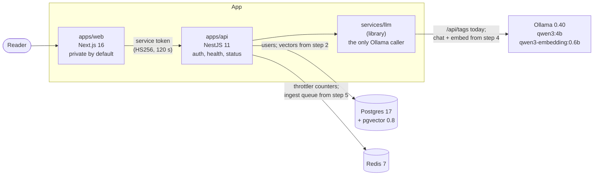

# rag-assistant: answers from your own documents, every claim cited, on an open model

[](https://github.com/bastian-red/rag-assistant/actions/workflows/ci.yml)

A question-answering assistant over documents you upload. Each person has a private library of
PDFs, markdown and text; an ingestion queue parses, chunks and embeds them into Postgres
(pgvector), and a question is answered by an open-weight model running locally under Ollama,
streamed token by token, with every claim pointing at the passage it came from. When the library
does not hold the answer, it says so instead of inventing one.

> **Status: build step 1 of 11, the scaffold.** What exists today: sign-in for two seeded
> accounts, a private-by-default web app, the API with its default-closed guard and documented
> rate-limit budgets, Postgres with the `vector` extension, Redis, and `services/llm`, the one
> place that talks to the model server, with an Ollama-compatible fake for CI. `/health` checks
> Postgres, Redis, the model server and that both models are pulled. Upload, ingestion, retrieval,
> the chat stream, the eval suite and the design arrive in steps 2 to 11, each with its tests. The
> demo GIF lands with the interface (step 11). Nothing here describes a feature that is not in the
> code.



The browser only talks to `apps/web`. The web tier holds no database credentials (a lint rule
refuses `@rag/db`, Prisma, Redis and BullMQ imports there), and no code outside `services/llm`
calls the model server.

## Why an open model, and which one

The model is `qwen3:4b` (chat) with `qwen3-embedding:0.6b` (embeddings), served by Ollama on the
same machine. The 4B chat model is the strongest that answers at a usable speed on an 8-core CPU
with 11 GB of RAM and no GPU, which is the machine this was built on; the names live in `.env`
(`CHAT_MODEL`, `EMBED_MODEL`), so a larger model on a bigger machine is a one-line change. No
proprietary inference API is called anywhere.

## Running it

Requires Node 20+, pnpm 9, Docker, and about 4 GB free in `$HOME` for Ollama and the two models.

```bash
pnpm install
cp .env.example .env
sed -i "s|^AUTH_SECRET=|AUTH_SECRET=$(openssl rand -base64 32)|" .env
docker compose -f infra/docker-compose.yml up -d     # Postgres (pgvector) :5445, Redis :6391
./scripts/ollama-setup.sh                             # Ollama, user-local, no sudo; pulls both models
pnpm db:deploy && pnpm db:seed
pnpm dev                                              # web :3600, api :4600
```

Open <http://localhost:3600> and sign in with a seeded account (local accounts for a local
database, published on purpose):

| Email            | Password              |
| ---------------- | --------------------- |
| `alma@rag.test`  | `alma-password-2026`  |
| `bruno@rag.test` | `bruno-password-2026` |

Each account sees only its own library.

`scripts/ollama-setup.sh` installs a pinned Ollama release (version and SHA-256 written in the
script, verified before unpacking) into `~/.local/ollama/`, links it at `~/.local/bin/ollama`,
starts `ollama serve` if nothing answers at `OLLAMA_URL`, and pulls `CHAT_MODEL` and
`EMBED_MODEL`. It is idempotent; `--check` only reports. On macOS or Windows, install Ollama from
its site and run the script with `--check`.

`pnpm dev` runs `scripts/dev.sh`, which loads `.env`, checks `AUTH_SECRET`, that Postgres and Redis
answer and that both models are pulled (printing the exact `ollama pull` if one is not), then
starts turbo. Turbo reads no `.env` itself and runs in strict environment mode, so without the
wrapper the API would boot with no secret. The web task waits for the API before `next dev`
opens its port, so the first page is never an "API unreachable" error.

The whole stack in containers: `docker compose -f infra/docker-compose.yml --profile app up -d
--build`. The containers use the host's Ollama through `host.docker.internal`, so the models are
downloaded once and stay out of the Docker disk. A machine with no host Ollama adds
`--profile ollama` (see the comment at the top of `infra/docker-compose.yml`).

## Testing

No CI lane runs a real model: GitHub's runners have no GPU and the models are gigabytes. Every
deterministic lane runs against the Ollama-compatible fake in `services/llm/src/fake/`, which
answers `/api/version` and `/api/tags` the way Ollama does and has a test-only control route to
take a model away. Answer quality is the eval lane's job (step 8), against the real model.

| Lane                 | Command                       | What it proves                                                                                                                                                                                                                                                                                                                                                                                                                                                                                                   |
| -------------------- | ----------------------------- | ---------------------------------------------------------------------------------------------------------------------------------------------------------------------------------------------------------------------------------------------------------------------------------------------------------------------------------------------------------------------------------------------------------------------------------------------------------------------------------------------------------------- |
| Gate (every commit)  | `pnpm test`                   | Contracts and model-name normalisation (an untagged name is `:latest`, a registry port is not a tag); the model client against present, missing and resized models, a refused connection (reported without the address), an HTML page and another service's JSON on the port, a 502 and a timeout; service tokens (incl. the `alg: none` forgery), config parsing, error mapping, the hashed rate-limit key, the private-by-default sign-in gate                                                                 |
| Environment contract | `pnpm env:contract`           | Source, `.env.example` and `turbo.json` agree in all four directions                                                                                                                                                                                                                                                                                                                                                                                                                                             |
| Seed check           | `./scripts/seed-check.sh`     | The seed is deterministic and idempotent (two runs, one digest) and creates both accounts                                                                                                                                                                                                                                                                                                                                                                                                                        |
| Schema drift         | `./scripts/db-drift.sh`       | The live database matches the Prisma schema column for column (`migrate status` only reads the ledger)                                                                                                                                                                                                                                                                                                                                                                                                           |
| Integration          | `./scripts/integration.sh`    | The `vector` extension at 0.8 or later and cosine distance working; each users constraint refusing its write by name; then the real Nest graph on Postgres and Redis at the documented budgets: sign-in, one answer for a wrong password and an unknown address, the default-closed guard, the exact route table, 5 sign-ins a minute per address and that budget limiting nothing else; `/health` 503 naming a missing model with the command that fixes it, and naming a dead model server without its address |
| Red proofs           | `node scripts/red-proofs.mjs` | Breaks each guarantee in the source (the default-closed guard, the auth budget's scope, the hashed limiter key, the models check, the model client's shape check, `:latest` resolution, the private-by-default gate), runs the suite that claims it, and fails unless that suite goes red                                                                                                                                                                                                                        |
| E2E                  | `./scripts/e2e.sh`            | Production build, Chromium and Firefox: sign-in for both accounts, deep links kept through sign-in, open-redirect refusal, the library private when signed out and again after sign-out, `/health` and `/status` including the degraded state when a model goes missing, axe with zero violations on every route in both colour schemes, no sideways scroll at 390 px                                                                                                                                            |
| Dev smoke            | `./scripts/dev-smoke.sh`      | The documented `pnpm dev` from a cold start, with every `.env` name stripped from its own environment: `/status` says every service is up on the very first request, `/health` sees Postgres, Redis, the model server and both models, and a sign-in reaches Postgres through the API                                                                                                                                                                                                                            |

The pre-commit hook runs gitleaks, the environment contract, the invisible-character and
self-import scans with their self-tests, the lockfile check and the gate lane. CI runs every lane
above plus lint, typecheck, a dependency audit and the two Docker image builds.

## Configuration

Every variable is documented in [`.env.example`](.env.example). `node scripts/env-contract.mjs`
fails if the code reads a name that `turbo.json` does not pass through or `.env.example` does not
document.

## Layout

```
apps/web         Next.js 16: sign-in, the library (empty until step 5), status
apps/api         NestJS 11: auth, health (Postgres, Redis, model server, models), status
services/llm     the only caller of Ollama: model checks today, chat and embeddings from step 4;
                 an Ollama-compatible fake for CI
packages/db      Prisma schema, migrations (the vector extension), the seed, schema tests
packages/shared  zod contracts (auth, health, model names), error vocabulary, service tokens
packages/config  shared tsconfig
infra/           docker-compose (pgvector, Redis, an optional Ollama) and one Dockerfile per process
e2e/             Playwright
scripts/         dev launcher, Ollama setup, lane scripts, contract checks, red proofs
```
